# Timberfall Island

**A cosy 3D survival tycoon for phones.** Your charter plane goes down over a frozen northern island. You wake on the shore with nothing but an axe. Chop trees, build a camp, keep warm through long nights, and fight off wolves and polar bears. Then team up with a trucking entrepreneur and grow your survival camp into a timber business that never stops expanding.

Current version: **v0.6.0** · Platform: HTML5 / WebGL (single file, works offline) · Target: entry-level Android phones

<p>
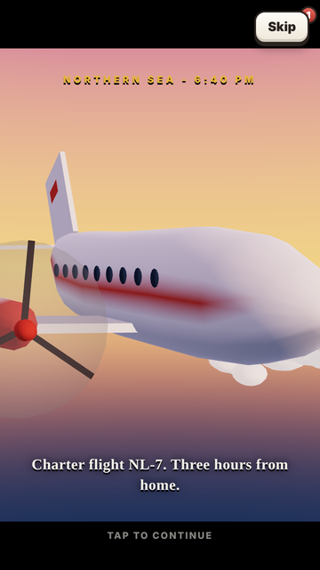
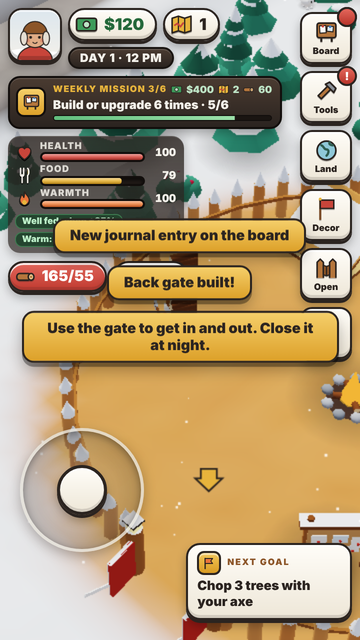
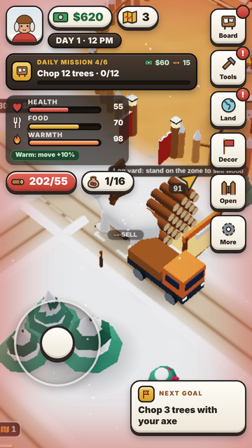
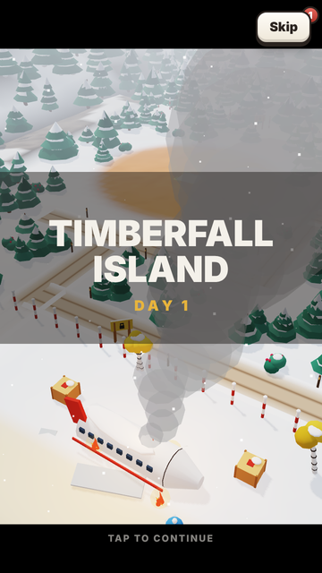
</p>

---

## The game

### Simple objective
The guide card on the right always shows one clear next step. In order, you:

1. Survive.
2. Build a camp.
3. Start a business.
4. Keep growing.

Missions refresh every day and every week.

### Core loop
- **Gather:** walk up to trees and you chop automatically. Bushes give berries. Hunt deer and hares, fish through holes in the frozen lake, and salvage crates from the wreck.
- **Build:** stand on a gold build pad with materials. You can build:
  - a campfire, a notice board, a shelter (3 levels) and storage
  - a palisade wall with closable front and back gates
  - a workbench
  - trade buildings
- **Survive:** keep Health, Food and Warmth up.
  - Nights are cold and bring wolves.
  - Polar bears den nearby and stay out in daylight.
  - Blizzards are announced 20 seconds ahead, then freeze and slow you, push you with the wind and stop the trucks.
- **Trade:** from day 3, Mara Vance of Northline Trading becomes your partner. Stand on a sale zone to drop off wood, food or fish, and her trucks arrive by barge, drive the island's roads and pay you in cash.
- **Grow:**
  - Upgrade axes, backpack and boots.
  - Hire a lumberjack. He goes home at night, opens and closes the gates himself, and repairs his camp first.
  - Unlock new land with cash and survey maps.

### Needs that matter
| Bar | Good (70+) | Low (under 25) | Empty (0) |
|---|---|---|---|
| Food | Well fed: chop 25% harder | Slower, weaker chopping | Losing health |
| Warmth | Warm: move 10% faster | Slower, weaker chopping | Losing health |
| Health | Heals while Food and Warmth are above 40 | Red warning on screen | You pass out by the fire and lose half your load |

You eat automatically from your food pouch. The guide turns red with **FREEZING**, **STARVING** or **HURT**, and its arrow points to the fire or to food.

### The island
| Region | Unlock | What's there |
|---|---|---|
| Crash Clearing | Start | Your camp, pines, berries, hares, the truck road |
| Wreck Shore | $250 + 1 map | The wreck, salvage crates, driftwood, the barge dock |
| Frozen Lake | $600 + 2 maps | Slippery ice, ice fishing, the fish market |
| Deep Woods | $1,000 + 3 maps | Dense forest, deer, polar bear dens |
| Pine Ridge | $1,600 + 4 maps | Huge old pines (+2 wood), the hunter's lodge |
| Timber Valley | $2,800 + 5 maps | Giant pines (+3 wood), deer herds, forgotten crates |

Mountains and forest surround the island, so the world never ends at a cut-off edge.

### Extras
- **Avatar:** choose skin, hair, coat, hat, face and portrait background, and change them any time.
- **Decorate your base:** buy lanterns that glow at night, snowmen, benches, flags, planters, sleds, stone paths, fences and totems. You can also change roof and flag colours. Move, rotate or put away anything, including your buildings.
- **Supply crates:** chopping trees very rarely drops one. Opening it plays a spinning reel, like a CS2 case or a Forza wheelspin, and the full prize list with odds is shown. Prizes include cash, maps, decor, a golden axe skin, and an ice sculpture and golden bear statue you can only get from crates.
- **Notice board:** daily and weekly missions, letters from Mara, and your survival journal.

---

## Screenshots

### Intro cinematic (3D, with sound)
| | | |
|---|---|---|
|  | 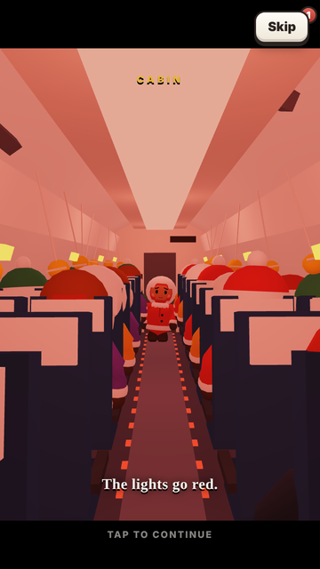 | 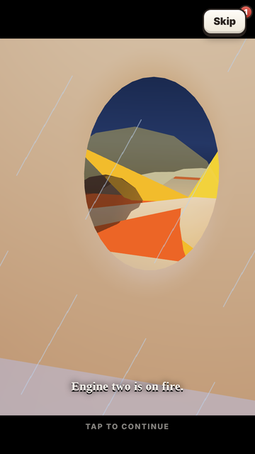 |
| *Charter flight NL-7 at sunset* | *Turbulence, then the lights go red* | *Engine two is on fire* |
| 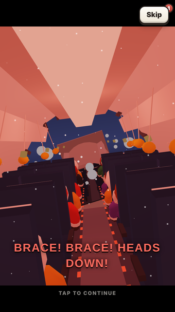 | 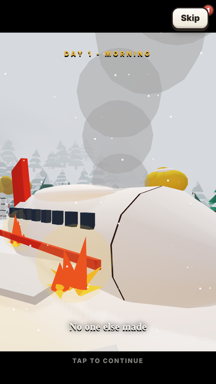 |  |
| *"BRACE! BRACE!": the tail tears away* | *You wake on a frozen shore* | *The camera rises over the island* |

### Gameplay
| | | | |
|---|---|---|---|
| 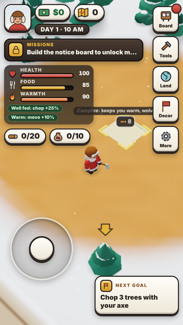 | 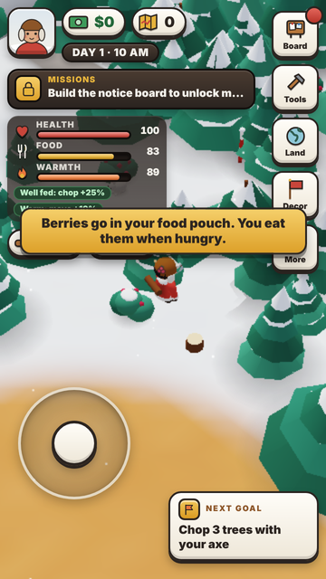 |  | 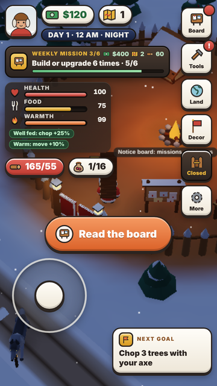 |
| *Day 1: missions on top, guide on the right* | *Auto-chopping and gathering* | *Palisade with gates* | *Wolves circle at night* |
|  | 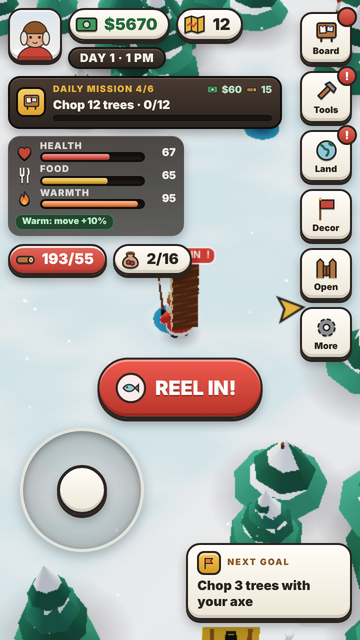 | 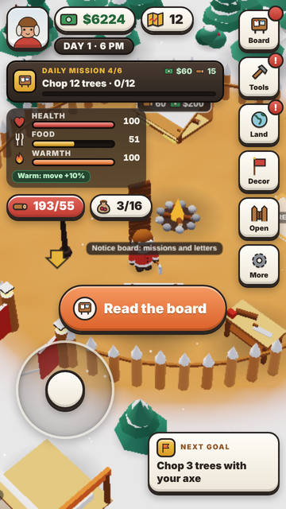 | 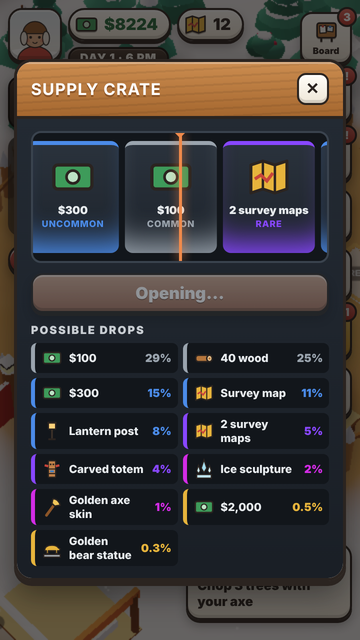 |
| *Northline trucks on the road* | *Ice fishing: wait for the bite* | *Decorating the base* | *Opening a supply crate* |
| 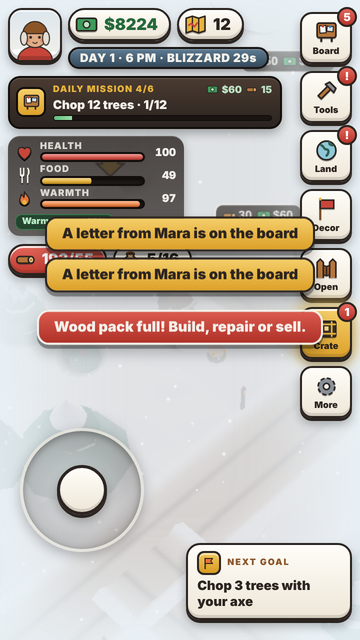 | 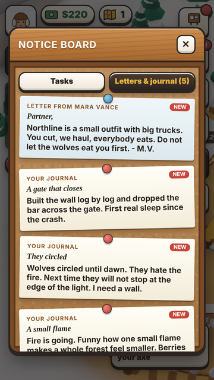 | | |
| *Blizzard* | *Notice board: letters and journal* | | |

> Gameplay screenshots come from the automated test run at Low graphics quality on a 360×640 screen. Medium and High add shadows and smoother edges.

---

## How to play
- **Move:** the fixed joystick at the bottom left. Settings can switch it to drag-anywhere. On a computer, use WASD or the arrow keys.
- **Act:** chopping, picking berries, hunting and depositing all happen automatically when you're close. Gates, fishing, the workbench and signs show a big button in the middle of the screen.
- **Side buttons:**
  - Board: missions and letters
  - Tools: upgrades
  - Land: unlock regions
  - Decor
  - Gate: open or close all gates
  - Crate: open a supply crate
  - More: settings, graphics quality, sound, controls and replaying the intro
- **Tips:**
  - Tap the Health, Food and Warmth panel to see what each bar does.
  - Tap the mission bar to open the board.

---

## What's new in v0.6.0
- **3D intro cinematic:**
  - Nine real camera shots: sunset flight, the cabin with oxygen masks, engine fire through the window, the mayday dive, the tail tearing away, the impact, a blackout, waking by the wreck, and finding the axe.
  - The sound is generated in code: engine, alarms, thunder, explosion, crash, wind, fire, shouting, screams, the mayday radio, ringing ears and a heartbeat.
- **Better models:**
  - Characters' sleeves, legs and coats are now joined into smooth shapes.
  - Wolves, polar bears, deer, foxes and hares are rebuilt as continuous bodies.
  - Trees come in 6 pine and 3 birch shapes.
- **Real roads:** packed snow with wheel ruts, snowbanks and marker posts. Trucks arrive by barge and follow the roads.
- **Bigger island:** the map is 33% wider, with the new Timber Valley region and mountains all round so the edge isn't cut off.
- **New HUD:**
  - Missions in a bar at the top.
  - The guide on the right side, with urgent warnings.
  - Labelled Health, Food and Warmth bars with status tags.
- **Needs now affect play:** well fed and warm make you faster and stronger. Cold and hunger slow you down.

### Version history
| Version | Highlights |
|---|---|
| v0.6.0 | 3D intro with sound, joined-up character and animal models, varied trees, roads and barge, Timber Valley, top mission bar, right-side guide, needs that change play |
| v0.5.0 | Blizzards that matter, kills leave meat, lumberjack shelters at night and repairs, fixed joystick, base decorating, supply crates with a reel animation, new wolf and bear models |
| v0.4.0 | Closed gates block the player, sale and repair floor zones, a real storage stockpile, bears by day, solid campfire, prey and predators, ice fishing, longer nights |
| v0.3.0 | Graphics overhaul: custom WebGL renderer with soft light, shadows and rounded low-poly models |
| v0.2.0 | Story intro scenes, bigger HUD, food pouch, closable walls and gates, raids, more animals, bigger map, notice board |
| v0.1.0 | First playable: crash, avatar, gathering, building, needs, day and night, entrepreneur, trucks, missions, land unlocks |

The full details are in [`DEVLOG.md`](DEVLOG.md). Each release is also saved in `versions/vX.Y.Z/` so you can roll back.

---

## For developers

### Project layout
```
src/
  logic.js        pure game rules: no DOM, deterministic, seeded RNG (shared by the game, tests and bot)
  game.js         input, HUD, modals, audio, intro sequencing, save/load
  index.html      markup + styles (placeholders are filled in by the build)
  gl/engine.js    tiny WebGL1 renderer: meshes, lighting, fog, shadows, skinning, instancing
  gl/models.js    every model built in code from primitives (box, cylinder, sphere, tube)
  gl/scene.js     turns game state into draw calls; camera override hooks for the cinematic
  gl/cine.js      the 3D intro shots
tests/
  logic.test.js   rule tests + a simulated player across 12 seeds × 14 days + save migrations
  smoke.mjs       Playwright run of every flow on a 360×640 screen; fails on any page error
build.mjs         inlines everything into dist/index.html (release) and dist/dev.html (debug hook)
versions/         snapshot of every release
```

### Commands
```bash
node build.mjs              # build dist/index.html and dist/dev.html
node tests/logic.test.js    # rules, saves, economy simulation
node tests/smoke.mjs        # full UI run, writes screenshots to shots/
```
To play, open `dist/index.html` in any modern browser. It runs fully offline.

### Versioning
`major.minor.patch`:
- **major:** a save-format break or a full redesign.
- **minor:** a new feature or system.
- **patch:** fixes and tuning.

The version lives in `src/logic.js`. Saves carry a schema number and migrate forward automatically. A save that can't be read is kept as a backup rather than overwritten.

### Saving
Progress is saved locally (localStorage) with a checksum and field-by-field validation. For cloud saves, accounts and leaderboards later, the recommended backend is **Supabase** (Postgres, authentication and row-level security). The save is already a single validated JSON document, so it can be stored as one row per player.

### Graphics quality
Low, Medium, High or Auto. Auto starts at Medium and steps down if the phone struggles. Low turns off shadows. If WebGL isn't available, the game falls back to a 2D Classic renderer.

---

## Status
This is a work in progress, so far tested in desktop Chrome at phone size. It still needs:
- testing on real low-end Android devices
- recorded sound files to replace the code-generated sounds
- store name checks before publishing
